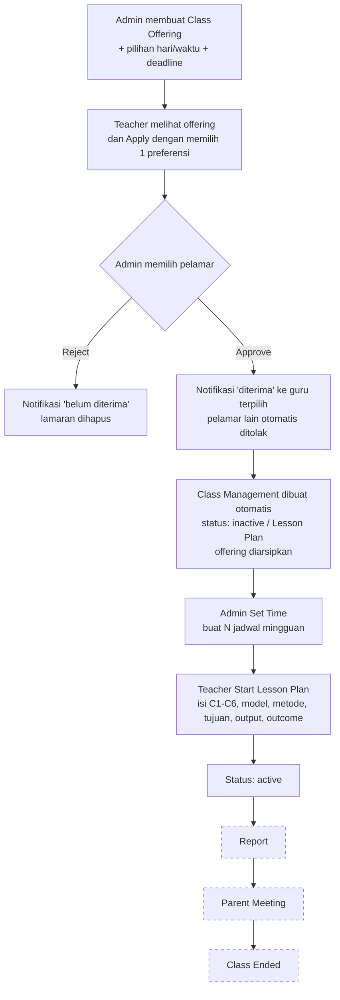

# 06 · Alur Fitur

[← Kembali ke README](../README.md)

Dokumen ini menjelaskan alur bisnis dari sudut pandang pengguna, lalu menunjuk file kode yang menjalankannya.

## Role Pengguna

| Role | Profil di tabel | Cara mendapatkan akun |
|------|-----------------|------------------------|
| `admin` | `curricula` | Seeder (`admin@localhost.com`) |
| `teacher` | `teachers` | Seeder, atau lewat endpoint register dengan `role=teacher` (form UI saat ini selalu mengirim `student`) |
| `student` | `students` | Halaman `/register` |

Role disimpan di kolom `users.role`. Pengecekan hak akses dilakukan di controller (`if ($user->role !== 'admin') abort(403);`). Belum ada Policy/Gate Laravel.

---

## Alur Utama: Dari Penawaran Kelas sampai Kelas Selesai

Kotak bergaris putus-putus = **belum ada kode backend** untuk pindah ke tahap tersebut (status `report`, `pm`, `ended` saat ini hanya muncul dari seeder).

### 1. Admin membuat Class Offering

- **Halaman:** `/classoffering` → tombol tambah → modal Create.
- **Isi form:** course, tipe (trial/regular/private), level, period, order, jadwal rencana, deadline (opsional, centang *has deadline*), catatan, dan minimal satu **preferensi** hari + waktu (Senin–Minggu × Pagi/Siang/Sore/Malam).
- Kapasitas siswa (`student`) diisi otomatis dari [Settings](#settings-maks-siswa-per-tipe-kelas).
- Deadline harus sebelum jadwal rencana.
- **Kode:** `ClassOffering/Index.tsx` → `handleSubmit` → `ClassOfferingController@store`.

### 2. Teacher melamar (Apply)

- Teacher melihat offering yang masih terbuka (tidak diarsip, belum lewat deadline).
- Klik Apply → pilih salah satu preferensi hari/waktu → kirim.
- Lamaran tersimpan dengan status `pending`. Satu teacher hanya bisa melamar sekali per offering.
- Offering yang sudah dilamar tetap terlihat oleh teacher tersebut walaupun sudah diarsip.
- **Kode:** `handleSubmitApply` → `ClassOfferingController@apply`.

### 3. Admin approve / reject

- Admin membuka daftar pelamar di kartu offering.
- **Reject:** pelamar dapat notifikasi "Mohon maaf anda belum diterima", lamaran dihapus. Offering tetap terbuka.
- **Approve** (dalam satu transaksi):
  - pelamar terpilih → `accepted` + notifikasi "Selamat anda diterima!";
  - pelamar lain → notifikasi ditolak + lamaran dihapus;
  - **kelas baru dibuat** di `class_management` dengan status `inactive`, `preferred_day` & `preferred_time` dari pilihan guru;
  - offering diarsipkan.
- Setelah diterima, offering hilang dari tampilan guru tersebut (kelasnya sudah ada di Class Management).
- **Kode:** `ClassOfferingController@approve` / `@reject`.

**Pengarsipan otomatis:** setiap kali halaman `/classoffering` dibuka, offering yang deadline-nya sudah lewat langsung diarsipkan (`autoArchiveOfferings()`).

### 4. Kelas juga bisa dibuat langsung

Selain lewat offering, admin dan teacher bisa membuat kelas langsung dari `/classmanagement` (tombol tambah di tab Lesson Plan). Jika teacher yang membuat, kelas otomatis jadi miliknya.

### 5. ID Kelas

ID kelas dibuat otomatis: **`{kode course}-{period}.{order}`**, contoh `QV-2.1`.
- Tampilan di tabel: `QV – 2.1`, ditambah ` – P1` jika tipe trial.
- ID harus unik. Jika kombinasi course + period + order sudah dipakai, muncul error *"Class ID … sudah digunakan."*
- ID tidak berubah saat kelas di-edit.
- **Kode:** `ClassManagement::booted()`.

### 6. Admin Set Time (membuat jadwal)

- Di tab Lesson Plan, admin klik **Set Time** pada kelas `inactive`.
- Tanggal default = hari terdekat sesuai `preferred_day` pilihan guru; jam default 09:00; 10 pertemuan.
- Admin bisa mengubah tanggal mulai, jam, dan jumlah pertemuan (1–20).
- Sistem membuat jadwal **mingguan** di `class_schedules` (jadwal lama dihapus jika Set Time diulang).
- **Kode:** `openSetTimeModal` / `handleSetTimeSubmit` → `ClassManagementController@setTime`.

### 7. Teacher membuat Lesson Plan

- Teacher melihat kelasnya di tab Lesson Plan. Baris tidak bisa diklik.
- Tombol **Start Lesson Plan** hanya aktif jika admin sudah Set Time. Jika belum, muncul modal "Admin belum mengatur jam".
- Isi form: *Cognitive Development* (C1 Remember, C2 Understanding, C3 Apply, C4 Analyze, C5 Evaluate, C6 Create — boleh lebih dari satu), Learning Model, Learning Method, Purpose, Output, Outcome.
- Setelah disimpan, status kelas berubah menjadi **`active`** dan teacher bisa membuka halaman detail kelas.
- Satu kelas hanya boleh punya satu lesson plan.
- **Kode:** `handleLessonPlanSubmit` → `ClassManagementController@storeLessonPlan`.

### 8. Halaman detail kelas (Active → Report → Parent Meeting)

- URL `/classmanagement/{id}`. Teacher hanya bisa membuka jika status bukan `inactive`.
- Berisi 4 tahap accordion: Lesson Plan, Active Class (absensi + riwayat sesi), Report (laporan per siswa), Parent Meeting.
- Daftar sesi diambil dari jadwal asli. **Data siswa, absensi, riwayat sesi, laporan, dan parent meeting masih dummy** dan perubahan hanya tersimpan di layar.
- **Kode:** `ClassManagementController@show` + `classroomPayload()`, `ClassManagement/Show.tsx`.

---

## Notifikasi

- Dibuat otomatis saat admin approve/reject lamaran.
- Badge jumlah belum dibaca muncul di menu **Notifications** di Sidebar (teacher & student; admin tidak).
- Jumlahnya dikirim ke semua halaman lewat prop global `unreadCount` (`HandleInertiaRequests`).
- Di halaman `/notifications`: klik notifikasi → ditandai dibaca + pindah ke link tujuan; ada tombol tandai semua dibaca.
- **Kode:** `Notification` model, `NotificationController`, `Notification/Index.tsx`, `Sidebar.tsx`.

## Settings (maks. siswa per tipe kelas)

- Hanya admin, menu **Settings** di Sidebar.
- Mengatur kapasitas siswa untuk tipe trial (default 5), regular (8), private (1).
- Nilai dipakai saat membuat kelas/offering baru, atau saat tipe kelas diubah. Kelas lama tidak ikut berubah.
- **Kode:** `ClassTypeSetting`, `SettingController`, `Setting/Index.tsx`.

## Dashboard per Role

| Role | Isi |
|------|-----|
| Admin | Jumlah total kelas, guru, siswa |
| Teacher | Sambutan + skor performa (dari kolom `teachers.performance`) + tabel pending attendance (contoh) |
| Student | Kelas yang diikuti & menunggu persetujuan (dari `class_students`) + jadwal terdekat |

Catatan: belum ada fitur untuk memasukkan siswa ke kelas, jadi dashboard student biasanya kosong.

## Profil

- Semua role bisa membuka `/profile` (klik kartu nama di Sidebar).
- Teacher bisa mengubah nama depan/belakang, tempat & tanggal lahir, domisili, nomor kartu, email.
- Student & admin mengubah nama dan email.
- Bisa ganti password dan hapus akun.

## Autentikasi

- **Login** `/login`: email + password, maksimal 5 kali gagal lalu dikunci sementara. Berhasil → `/dashboard`.
- **Register** `/register`: nama, email, password → akun student + login otomatis.
- **Lupa password**, **reset password**, **verifikasi email**: bawaan Breeze.
- **Logout**: tombol di bawah Sidebar.

## Akses dari Luar (Tailscale)

Aplikasi pernah disiapkan agar bisa diakses lewat **Tailscale Funnel** di host `arrijal-ifal-ideapad.taildef515.ts.net`. Pengaturannya ada di `bootstrap/app.php` (trusted host & proxy) dan `AppServiceProvider` (paksa HTTPS). Lihat [01-arsitektur](01-arsitektur-dan-setup.md#bootstrapappphp).
