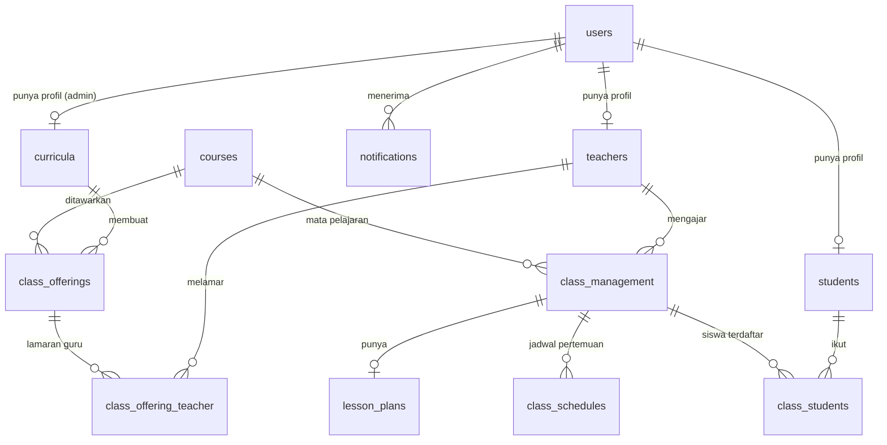

# 02 · Database & Model

[← Kembali ke README](../../README.md)

Dokumen ini menjelaskan semua tabel (dari `database/migrations/`), model Eloquent (dari `app/Models/`), dan data dummy (seeder & factory).

## Diagram Relasi (ERD)

Hanya tabel yang benar-benar dipakai fitur. Tabel kosong/belum dipakai dibahas di [bagian bawah](#tabel-yang-belum-dipakai).

`class_type_settings` berdiri sendiri (tanpa relasi), menyimpan batas maksimal siswa per tipe kelas.

---

## Tabel & Model Utama

Format: kolom → tipe → keterangan. Kolom `id`, `created_at`, `updated_at` ada di hampir semua tabel dan tidak ditulis ulang kecuali penting.

### `users` — Model `User`

Migration: `0001_01_01_000000_create_users_table.php`

| Kolom | Tipe | Keterangan |
|-------|------|------------|
| `name` | string | Nama tampilan |
| `email` | string, unique | Email login |
| `email_verified_at` | timestamp, nullable | Waktu verifikasi email |
| `password` | string | Otomatis di-hash (cast `hashed`) |
| `role` | string, nullable | `admin`, `teacher`, atau `student` |
| `remember_token` | string | Untuk "Remember me" |

Migration yang sama juga membuat tabel `password_reset_tokens` dan `sessions` (bawaan Laravel).

**Model `User`** (`app/Models/User.php`)
- Konstanta `ROLES = ['admin', 'student', 'teacher', 'curriculum']` (catatan: `curriculum` tidak dipakai sebagai role; admin justru punya profil di tabel `curricula`).
- `$fillable`: `name`, `role`, `email`, `password`
- `$hidden`: `password`, `remember_token`
- Relasi:
  - `student()` → hasOne `Student`
  - `teacher()` → hasOne `Teacher`
  - `curriculum()` → hasOne `Curriculum`

### `teachers` — Model `Teacher`

Migration: `2026_02_23_152443_create_teachers_table.php`

| Kolom | Tipe | Keterangan |
|-------|------|------------|
| `user_id` | FK → users, cascade delete | Akun pemilik profil |
| `first_name` | string | Nama depan |
| `last_name` | string, nullable | Nama belakang |
| `pob` | string, nullable | *Place of birth* (tempat lahir) |
| `dob` | datetime, nullable | *Date of birth* (tanggal lahir) |
| `domicile` | string, nullable | Domisili |
| `card_number` | string, nullable | Nomor kartu/identitas |
| `bachelor`, `master`, `doctoral` | string, nullable | Riwayat pendidikan S1/S2/S3 |
| `performance` | decimal | Skor performa guru (ditampilkan di dashboard teacher, standar 75%) |

**Model `Teacher`**
- `$fillable`: `user_id`, `first_name`, `last_name`, `pob`, `dob`, `domicile`, `card_number`, `performance`
- Relasi: `user()` belongsTo `User`, `class_management()` hasMany `ClassManagement`, `mood_trackers()` hasMany `MoodTracker`

### `students` — Model `Student`

Migration: `2026_02_23_152415_create_students_table.php`

| Kolom | Tipe | Keterangan |
|-------|------|------------|
| `user_id` | FK → users, cascade delete | Akun pemilik profil |
| `name` | string | Nama siswa |

**Model `Student`**
- `$fillable`: `user_id`, `name`, `first_name`, `last_name`, `pob`, `dob`, `domicile`, `card_number` (kolom selain `user_id` dan `name` **tidak ada** di tabel — lihat [08-catatan](08-catatan-dan-masalah.md))
- Relasi:
  - `user()` / `users()` → belongsTo `User` (dua nama, isi sama)
  - `classStudents()` → hasMany `ClassStudent`
  - `classes()` → belongsToMany `ClassManagement` lewat tabel `class_students`, dengan pivot `id`, `status`, `notes`, `created_at`
  - `enrolledClasses()` → `classes()` yang status pivot-nya `enrolled`
  - `course_meetings()`, `attendances()`, `courses()` → relasi lama, belum dipakai

### `curricula` — Model `Curriculum`

Migration: `2026_03_12_160714_create_curricula_table.php`. Profil untuk user ber-role **admin** (tim kurikulum).

| Kolom | Tipe | Keterangan |
|-------|------|------------|
| `user_id` | FK → users, cascade delete | |
| `first_name` | string | |
| `last_name` | string, nullable | |

Relasi: `user()` belongsTo `User`.

### `courses` — Model `Course`

Migration: `2026_02_23_152824_create_courses_table.php`. Daftar mata pelajaran/program.

| Kolom | Tipe | Keterangan |
|-------|------|------------|
| `subject` | string | Kode singkat, mis. `QV`, `EQD`, `STEM`. Dipakai sebagai awalan ID kelas. |
| `description` | longText, nullable | Nama lengkap, mis. "Quranic Vibrance" |

`$fillable`: `subject`, `description`. Relasi: `available_course()` hasMany `AvailableCourse` (lama, belum dipakai).

### `class_offerings` — Model `ClassOffering`

Migration: `2026_05_24_150503_create_class_offerings_table.php`. Penawaran kelas dari admin yang bisa dilamar guru.

| Kolom | Tipe | Keterangan |
|-------|------|------------|
| `curriculum_id` | FK → curricula | Admin pembuat penawaran |
| `course_id` | FK → courses | Mata pelajaran |
| `level` | integer | Level kelas |
| `period` | integer | Periode |
| `order` | integer | Urutan kelas di periode tersebut |
| `type` | string | `trial`, `regular`, atau `private` |
| `student` | integer, default 0 | Kapasitas siswa (diisi otomatis dari `class_type_settings`) |
| `schedule_at` | datetime, nullable | Rencana jadwal mulai |
| `note` | longText, nullable | Catatan |
| `preferences` | json, nullable | Pilihan hari & waktu, contoh: `[{"day":"Monday","time":"Morning"}, ...]` |
| `is_archived` | boolean, default **true** | Diarsipkan atau tidak (controller mengisi `false` saat create) |
| `close_offering` | datetime, nullable | Batas waktu melamar. `null` = tanpa batas |

**Model `ClassOffering`**
- `$casts`: `schedule_at`, `close_offering` → datetime; `is_archived` → boolean; `preferences` → array
- Relasi: `course()`, `curriculum()`, `teacherApplications()` hasMany `ClassOfferingTeacher`
- Accessor: `applied_teachers` (lamaran status `pending`), `accepted_teacher` (lamaran status `accepted`)

### `class_offering_teacher` — Model `ClassOfferingTeacher`

Migration: `2026_08_15_073428_create_class_offering_teacher.php`. Lamaran guru ke sebuah offering.

| Kolom | Tipe | Keterangan |
|-------|------|------------|
| `class_offering_id` | FK → class_offerings, cascade | |
| `teacher_id` | FK → teachers, cascade | |
| `status` | string | `pending` atau `accepted` (yang ditolak langsung dihapus barisnya) |
| `selected_preference` | integer, nullable | **Indeks** array `preferences` yang dipilih guru (0, 1, 2, …) |
| `approved_at` | datetime, nullable | Waktu diterima admin |

Relasi: `classOffering()`, `teacher()`.

### `class_management` — Model `ClassManagement`

Migration: `2026_05_22_083151_create_class_management_table.php`. Kelas yang sudah berjalan/akan berjalan.

| Kolom | Tipe | Keterangan |
|-------|------|------------|
| `id` | **string**, primary key | Format `{subject}-{period}.{order}`, mis. `QV-2.1`. Dibuat otomatis. |
| `course_id` | FK → courses, cascade | |
| `teacher_id` | FK → teachers, nullable, cascade | Guru pengajar |
| `level` | integer | |
| `period` | integer | |
| `order` | integer | |
| `type` | string | `trial`, `regular`, `private` |
| `session` | integer, default 0 | Jumlah pertemuan |
| `student` | integer, default 0 | Kapasitas siswa |
| `schedule_at` | datetime, nullable | Jadwal pertemuan pertama |
| `note` | longText | Catatan (wajib ada, controller mengisi `''` jika kosong) |
| `preferred_day` | string, nullable | Hari pilihan guru dari offering, mis. `Monday` |
| `preferred_time` | string, nullable | Waktu pilihan guru, mis. `Morning` |
| `status` | string, default `inactive` | Tahap kelas (lihat tabel status di bawah) |
| `planned` | boolean, default false | Belum dipakai di logika (hanya diisi seeder) |

**Status kelas:**

| Nilai di DB | Label di halaman Index | Key di halaman Show |
|-------------|-----------------------|---------------------|
| `inactive` | Lesson Plan | `lesson_plan` |
| `active` | Active | `active` |
| `report` | Report | `report` |
| `pm` | Parent Meeting | `parent_meeting` |
| `ended` | Class Ended | `ended` |

**Model `ClassManagement`**
- `$table = 'class_management'`, `$incrementing = false`, `$keyType = 'string'` (karena ID berupa teks)
- **Event `creating`** (di method `booted()`): sebelum disimpan, jika `id` kosong, ID dibuat dari `Course->subject` + `period` + `order`. Jika ID sudah dipakai → lempar `ValidationException` dengan pesan *"Class ID {id} sudah digunakan."* pada field `order`.
- `$fillable`: `course_id`, `teacher_id`, `level`, `period`, `order`, `type`, `session`, `student`, `schedule_at`, `note`, `status`, `preferred_day`, `preferred_time`
- `$casts`: `schedule_at` → datetime
- Relasi & method:
  - `course()`, `teacher()` → belongsTo
  - `lessonPlan()` → hasOne `LessonPlan`
  - `schedules()` → hasMany `ClassSchedule`
  - `hasSchedule()` → `true` jika punya minimal 1 jadwal
  - `classStudents()` → hasMany `ClassStudent`
  - `students()` → belongsToMany `Student` lewat `class_students` (pivot `id`, `status`, `notes`, `created_at`)
  - `enrolledStudents()` / `pendingStudents()` → `students()` difilter status pivot

### `class_schedules` — Model `ClassSchedule`

Migration: `2026_08_23_115207_create_class_schedules_table.php`. Satu baris = satu pertemuan.

| Kolom | Tipe | Keterangan |
|-------|------|------------|
| `class_management_id` | string, FK → class_management.id, cascade | |
| `meeting_number` | integer | Pertemuan ke-berapa (1, 2, 3, …) |
| `schedule_at` | datetime | Tanggal & jam pertemuan |

Unique: (`class_management_id`, `meeting_number`). Relasi: `classManagement()`.

### `lesson_plans` — Model `LessonPlan`

Migration: `2026_08_20_080845_create_lesson_plans_table.php`. Satu kelas punya maksimal satu lesson plan.

| Kolom | Tipe | Keterangan |
|-------|------|------------|
| `class_management_id` | string, FK → class_management.id, cascade | |
| `cdev` | json | *Cognitive Development* (taksonomi Bloom) yang dipilih: `c1` Remember, `c2` Understanding, `c3` Apply, `c4` Analyze, `c5` Evaluate, `c6` Create |
| `model` | string | Model pembelajaran (mis. Project Based Learning) |
| `method` | string | Metode pembelajaran (mis. Discussion) |
| `purpose` | longText | Tujuan pembelajaran |
| `output` | longText | Rencana output |
| `outcome` | longText | Rencana outcome |

Model: `$guarded = []` (semua kolom boleh diisi), `$casts`: `cdev` → array. Relasi: `classmanagement()`.

### `class_students` — Model `ClassStudent`

Migration: `2026_10_06_165925_create_class_students_table.php`. Tabel penghubung siswa ↔ kelas.

| Kolom | Tipe | Keterangan |
|-------|------|------------|
| `class_management_id` | string, FK, cascade | |
| `student_id` | FK → students, cascade | |
| `status` | string, default `enrolled` | `pending`, `enrolled`, `rejected` |
| `notes` | text, nullable | |

Unique: (`class_management_id`, `student_id`). Relasi: `classManagement()`, `student()`.

> Tabel ini sudah dibaca oleh Dashboard student, tetapi **belum ada kode yang mengisinya** (route enroll/tambah siswa belum punya method di controller). Lihat [08-catatan](08-catatan-dan-masalah.md).

### `notifications` — Model `Notification`

Migration: `2026_05_28_055806_create_notifications_table.php`.

| Kolom | Tipe | Keterangan |
|-------|------|------------|
| `user_id` | FK → users, cascade | Penerima |
| `type` | string | Saat ini: `class_offering_accepted`, `class_offering_rejected` |
| `title` | string | Judul |
| `text` | longText | Isi pesan |
| `href` | string | Link tujuan saat notifikasi diklik |
| `read` | boolean | Sudah dibaca atau belum |

Model: `$casts` `read` → boolean; scope `unread()`; method `markAsRead()`; relasi `user()`.

> Ini tabel notifikasi **buatan sendiri**, bukan sistem notifikasi bawaan Laravel (`Notifiable`).

### `class_type_settings` — Model `ClassTypeSetting`

Migration: `2026_10_10_000000_create_class_type_settings_table.php`. Migration ini langsung mengisi data awal.

| Kolom | Tipe | Default dari migration |
|-------|------|------------------------|
| `type` | string, unique | `trial` / `regular` / `private` |
| `max_student` | unsigned integer | 5 / 8 / 1 |

Model:
- Konstanta `TYPES = ['trial', 'regular', 'private']`
- `maxStudentFor(string $type): int` → ambil `max_student` untuk tipe tersebut (0 jika tidak ada). Dipanggil saat membuat/mengubah tipe kelas atau offering.

---

## Tabel yang Belum Dipakai

Tabel berikut sudah ada migration & model, tapi belum dipakai fitur mana pun (sisa rancangan awal atau rencana ke depan):

| Tabel | Model | Isi kolom | Catatan |
|-------|-------|-----------|---------|
| `available_courses` | `AvailableCourse` | course_id, teacher_id, level, period, order, type, session, student, schedule_at, note, status | Pendahulu `class_management`. Migration-nya juga membuat tabel `course_student` (course_id, student_id). |
| `course_meetings` | `CourseMeeting` | course_id, meeting_date, topic, meeting_url | Rencana awal pertemuan, digantikan `class_schedules` |
| `attendances` | `Attendance` | course_meeting_id, student_id, is_present, notes | Rencana absensi. Absensi di halaman Show saat ini masih dummy. |
| `mood_trackers` | `MoodTracker` | teacher_id, level, entry_date (unique per guru per hari) | Pelacak mood guru |
| `course_interests` | `CourseInterest` | course_id, teacher_id | Minat guru pada course |
| `books` | `Book` | (hanya id & timestamps) | Kosong |
| `revenues` | `Revenue` | (hanya id & timestamps) | Halaman Revenue masih dummy |
| `modules` | `Module` | (hanya id & timestamps) | Halaman Module masih dummy |
| `parent_meetings` | `ParentMeeting` | (hanya id & timestamps) | Halaman Parent Meeting masih dummy |

Tabel bawaan Laravel lain: `cache`, `cache_locks` (migration `..._000001`), `jobs`, `job_batches`, `failed_jobs` (migration `..._000002`).

---

## Seeder

Jalankan dengan `php artisan db:seed` atau `php artisan migrate:fresh --seed`.

| File | Fungsi |
|------|--------|
| `DatabaseSeeder.php` | Memanggil `CourseSeeder` lalu `UserSeeder` |
| `CourseSeeder.php` | Membuat 4 course: `EQD` (Emotional Quotient Development), `QV` (Quranic Vibrance), `LP` (Language Project), `CPF` (Coaching Positive Future) |
| `UserSeeder.php` | Membuat akun dummy + 3 course tambahan + 3 kelas (detail di bawah) |
| `ClassManagementSeeder.php` | Membuat 20 kelas acak. **Tidak dipanggil** oleh `DatabaseSeeder`; jalankan manual: `php artisan db:seed --class=ClassManagementSeeder`. Bisa gagal jika kombinasi acak menghasilkan ID kelas yang sama. |
| `TeacherSeeder.php` | Kosong |

**Isi `UserSeeder`:**

| Akun | Profil | Kelas yang dibuat |
|------|--------|-------------------|
| `admin@localhost.com` / `admin123` | Curriculum "Admin" | – |
| `teacher1@localhost.com` / `teacher123` | Teacher "Guru Besar", performance 67.67 | `STEM-1.1`, trial, status `inactive` |
| `teacher2@localhost.com` / `teacher123` | Teacher "Guru Sedang" | `IF-3.3`, regular, status `active` |
| `teacher3@localhost.com` / `teacher123` | Teacher "Guru Kecil" | `ILC-1.2`, private, status `report` |
| `student1@localhost.com` / `student123` | Student "Muhammad Al-Fatih" | – |
| `student2@localhost.com` / `student123` | Student "Reza Alfian" | – |
| `student3@localhost.com` / `student123` | Student "Aisyah Putri" | – |

Course tambahan dari `UserSeeder`: `STEM` (STEM Creativity), `IF` (Islamic Finance), `ILC` (Islamic Leadership and Collaborration).

## Factory

Ada di `database/factories/`, dipakai oleh test untuk membuat data palsu. Factory untuk hampir semua model tersedia. Yang paling sering dipakai:

- `UserFactory` — user acak
- `CourseFactory` — course acak
- `ClassManagementFactory` — kelas dengan default: `level 1`, `period '2026-Q1'`, `order 1`, `type regular`, `status inactive`, `note ''`, course dibuat otomatis
